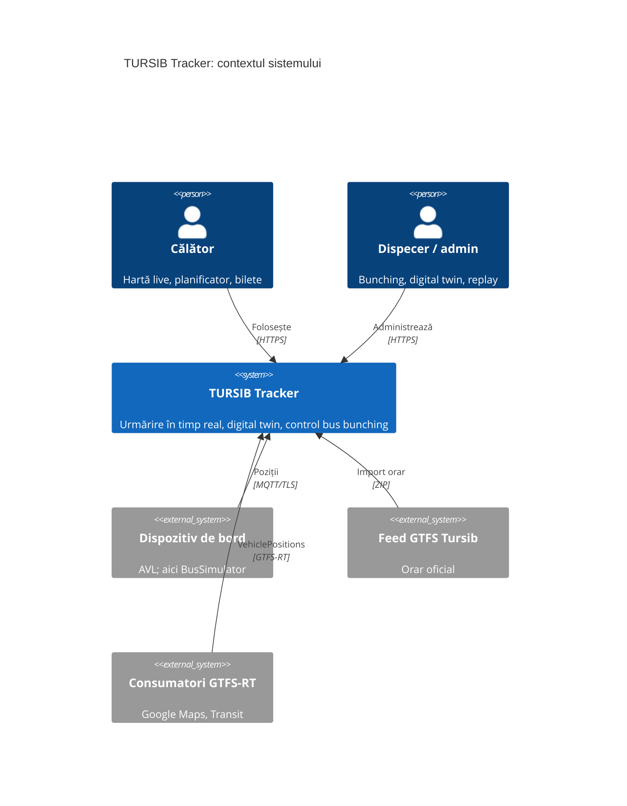
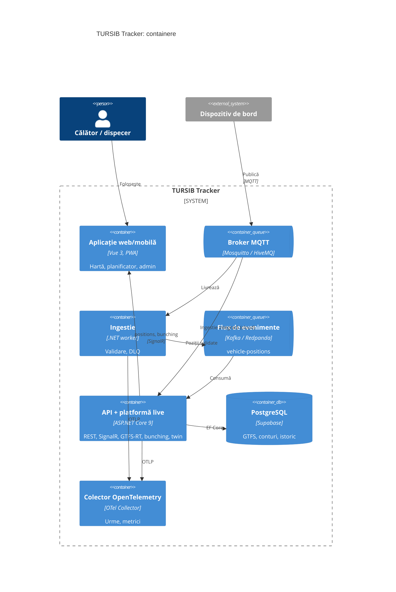
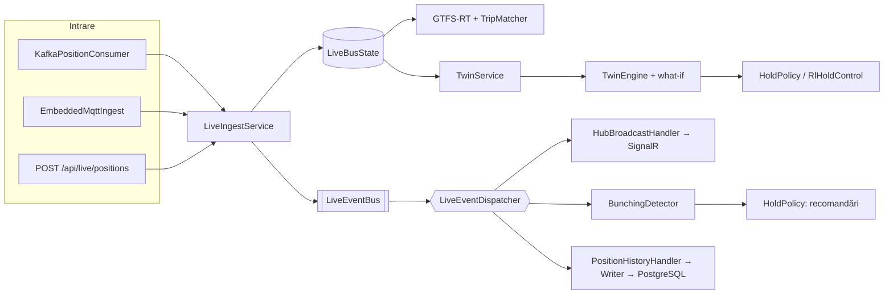

# Modelul C4

Sursa canonică e [`workspace.dsl`](workspace.dsl) (Structurizr). Diagramele de mai jos sunt aceeași structură, în
Mermaid, ca să se vadă direct pe GitHub.

## Nivelul 1: context

## Nivelul 2: containere

## Nivelul 3: componentele backend-ului

Regula de extindere: un consumator nou al pozițiilor live e un `IBusPositionHandler` nou, înregistrat în `Program.cs`.
Producătorii nu se schimbă.
