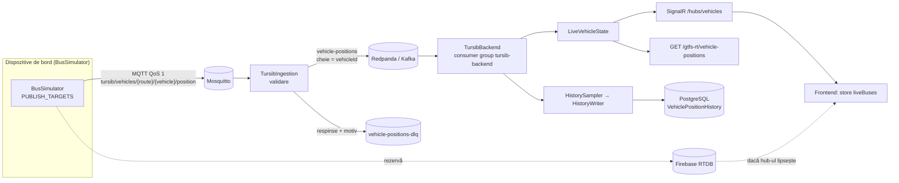

# Etapa 2: pipeline-ul de evenimente



## Rulare locală
```bash
docker compose --profile events up -d mosquitto redpanda redpanda-init redpanda-console ingestion
# simulatorul, ca dispozitiv MQTT (backend-ul pe :5022 servește rutele)
cd BusSimulator && PUBLISH_TARGETS=mqtt TURSIB_API_URL=http://localhost:5022/api dotnet run
# backend-ul, consumând Kafka
cd TursibBackend && Kafka__BootstrapServers=localhost:19092 dotnet run
```

- Redpanda Console: http://localhost:8081 (topic-uri, mesaje, consumer groups)
- Ingestie: `docker compose logs ingestion` și `/health` (contoare)
- GTFS-RT: http://localhost:5022/gtfs-rt/vehicle-positions?format=json

## Calitate (scenarii de verificat)

| Atribut | Scenariu | Țintă |
|---|---|---|
| Latență | poziție publicată → marker mutat pe hartă | < 1,5 s (lot de 500 ms + rețea) |
| Disponibilitate | backend-ul sau Kafka cad | harta trece pe Firebase, fără ecran gol |
| Integritate | mesaj în afara zonei / JSON invalid | ajunge în DLQ, nu pe hartă |
| Ordine | mesaje redistribuite sau întârziate | poziția mai veche e ignorată (`LiveVehicleState`) |
| Volum istoric | 171 autobuze, 24 h | ~3 milioane rânduri, retenție 3 zile |
