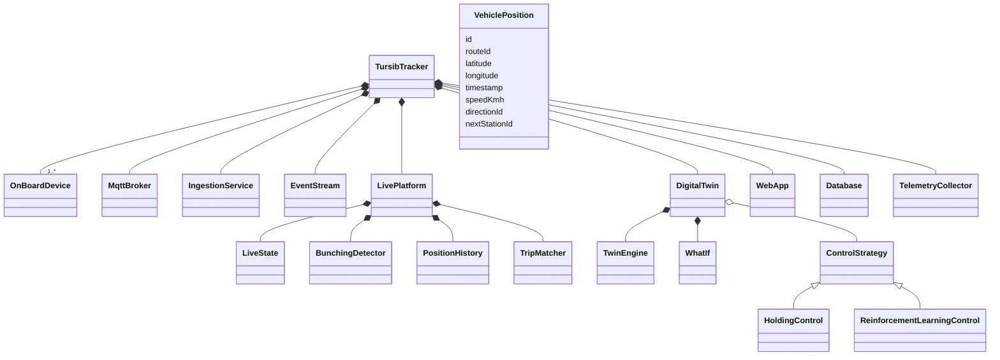
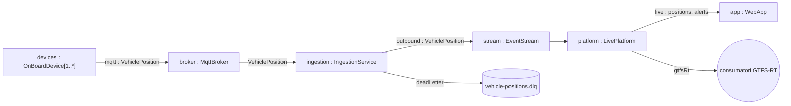
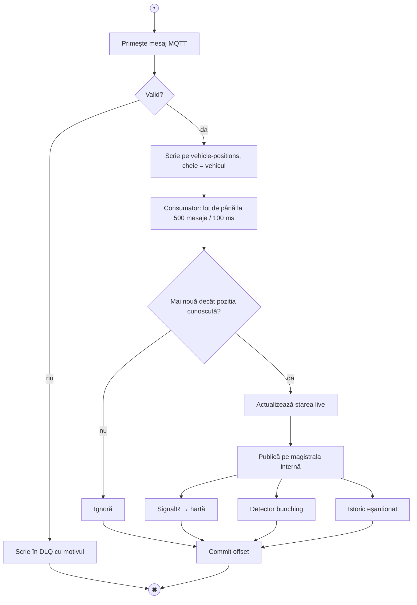
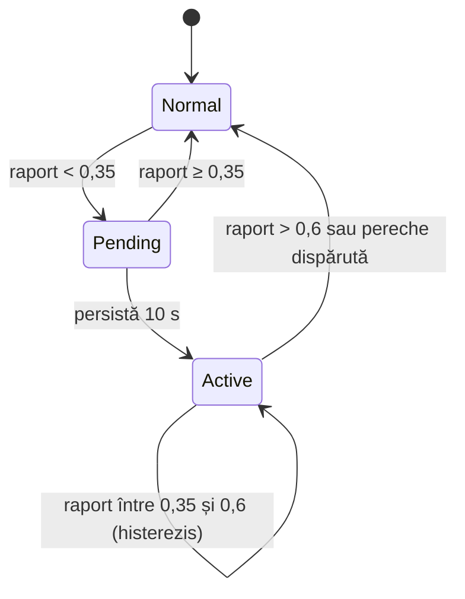
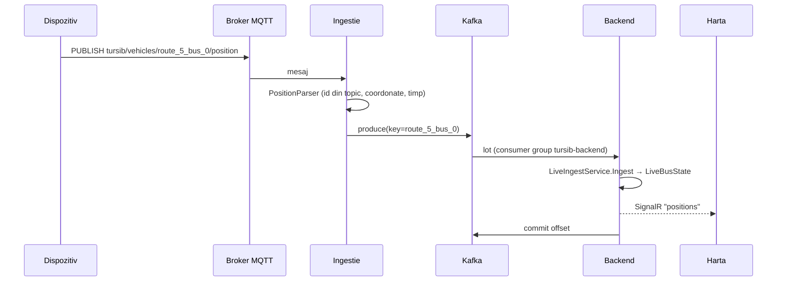

# Modelul SysML

Modelul textual e în [`tursib.sysml`](tursib.sysml) (SysML v2): blocuri (`part def`), porturi și elementele care
circulă prin ele, conexiuni, comportamentul principal, mașina de stări a alertei și cerințele, cu legături `satisfy`
către părțile care le îndeplinesc. Mai jos, diagramele principale, redate în Mermaid.

## Definiția blocurilor (BDD)

## Blocul intern (IBD): drumul unei poziții

## Activitate: procesarea unei poziții

## Stări: alerta de bunching

## Secvență: de la dispozitiv la hartă

